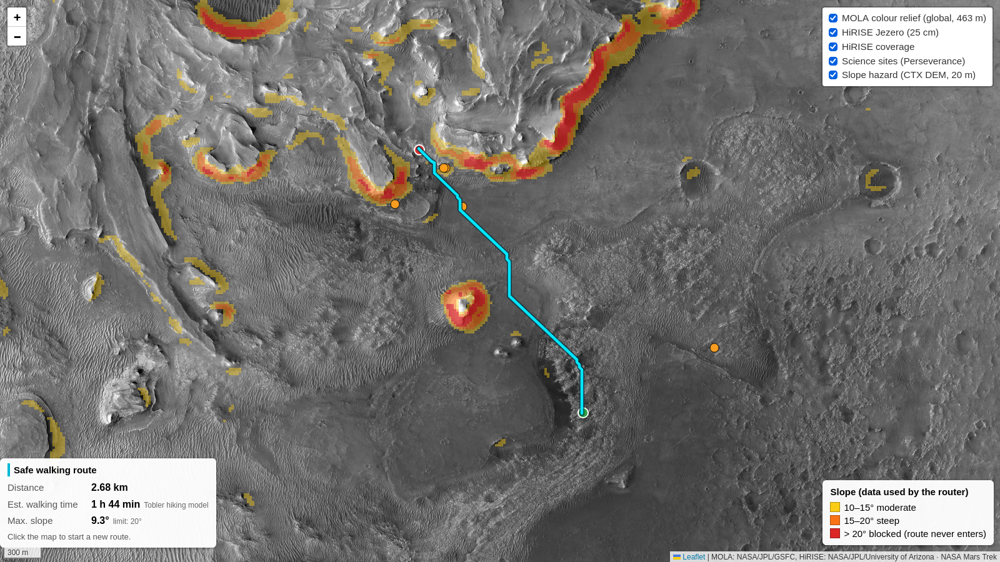

# Jezero Safe Route — a layered Marswalk planner

NASA Space Apps Challenge 2026 · Challenge: **Interplanetary Survival Guide: Martian Map**

Click two points in Jezero Crater, Mars, and get a walking route computed in real time from orbital elevation data. The route avoids slopes steeper than 20° and reports distance, estimated walking time and the steepest slope along the way. A slope-hazard layer shows why the route bends, and Perseverance science sites show what an explorer could study on the walk.



## Features

- **Live route computation:** weighted A* on a 20 m/pixel elevation model; a 20 km route takes about 2 seconds.
- **Safety limit:** cells steeper than 20° are never used.
- **Route summary:** distance, estimated walking time, maximum slope.
- **Slope-hazard layer:** yellow 10–15°, orange 15–20°, red above 20° (the route never enters red cells).
- **Science sites:** five Perseverance locations with rover photos, credits and one-sentence science summaries.
- **NASA imagery:** 25 cm/pixel HiRISE base map from NASA Mars Trek.

## Data layers

| Layer | Mission / instrument | Source |
|---|---|---|
| Base map, 25 cm/pixel | Mars Reconnaissance Orbiter / HiRISE | NASA Mars Trek |
| Elevation, 20 m/pixel | Mars Reconnaissance Orbiter / CTX | USGS Mars 2020 Science Investigation CTX DEM mosaic |
| Science sites and photos | Mars 2020 Perseverance | Perseverance waypoints and raw images |
| Global context, 463 m/pixel | Mars Global Surveyor / MOLA | NASA Mars Trek |

Full links and credits: [`data_sources.md`](data_sources.md).

## Quick start

Requirements: Python 3.10+, `curl`.

1. **Download the elevation model** (about 90 MB, not stored in git):
   ```bash
   curl -L -o data/jezero_dem.tif "https://planetarymaps.usgs.gov/mosaic/mars2020_trn/CTX/ScienceInvestigationMaps_JPL/M20_JezeroCrater_CTXDEM_20m.tif"
   ```
   On Windows PowerShell use `curl.exe`. Expected SHA-256: `BA7F706EA1B5D63A562F28A7DCF7A7F3C79BCE7F048E6974B57E8A33C30D1BA2`.

2. **Start the backend:**
   ```bash
   cd backend
   pip install -r requirements.txt
   python app.py
   ```
   The API runs at `http://localhost:5000`.

3. **Start the frontend** in a second terminal, from the repository root:
   ```bash
   python -m http.server 8000
   ```
   Open `http://localhost:8000/frontend/index.html`.

4. **Use it:** click a start point, then an end point. Click again to start a new route. Turn on "Eğim tehlikesi" in the layer panel to see the hazard layer.

## How the route is computed

1. **Elevation:** the CTX DEM is read with rasterio. Its projection (equirectangular on the Mars 2000 sphere) is read from the file and used to convert latitude/longitude to DEM pixels.
2. **Slope** is computed for every 20 m cell.
3. **Walking cost:** Tobler's hiking function converts slope to walking speed, scaled to a 2.2 km/h EVA pace. Each cell's cost is the time needed to cross it.
4. **Safety limit:** cells steeper than 20° or without data are impassable.
5. **Search:** weighted A* (weight 1.2). Route cost is guaranteed to be within 20% of the optimum; in our tests the difference was about 2%.

API details: [`docs/integration.md`](docs/integration.md).

## Testing

- **Backend unit tests:** `cd backend && python -m pytest tests/ -v`
- **Integration test suite and reports:** [`tests/`](tests/) and [`docs/`](docs/)
- **End-to-end browser tests** (headless Firefox): route drawing, reset, error messages, science-site popups, layer panel.
- **Consistency check:** 13 random routes, 6,060 route points; none falls on a cell above the 20° limit. This confirms that the hazard layer and the routing engine are aligned.

## Limitations

- A 20 m elevation model cannot see boulders or small scarps, so real slopes can be steeper than the model shows. **The route is a planning aid, not a safety certification.**
- The 20° limit is a conservative prototype parameter, not a NASA standard.
- The 2.2 km/h walking pace is an adapted assumption, not measured astronaut performance.
- The global MOLA layer (463 m/pixel) is visual context only; routing uses the 20 m CTX DEM.
- One request covers at most 30 km straight-line distance (a realistic single EVA); longer requests return 422.

## Future work

- Whole-Mars coarse routes from the global MOLA elevation model, labeled with a data-confidence level.
- A user-adjustable slope limit in the interface.
- Finer slopes from the 1 m HiRISE elevation model.
- Multi-stop routes that visit several science sites.

## Earth relevance

The same pipeline (elevation model → slope → walking cost → safest path) applies to search-and-rescue planning, mountain hiking and analog-astronaut field missions. NASA uses Lake Salda in Türkiye as an Earth analogue for Jezero because both have carbonate-bearing lake and delta deposits.

## Repository layout

```
backend/    Flask API, DEM processing, routing, overlay script, tests
frontend/   Leaflet map (index.html, config.js, app.js), hazard overlay
data/       Science sites (science_points.json); the DEM goes here (not in git)
docs/       Integration guide, test reports, submission draft
tests/      Integration and contract test suite
```

## Team

- **Yusuf Öztoprak** — Backend & routing; documentation & presentation
- **Yusuf Tunç** — Frontend & map; documentation & presentation
- **Eren Yılmaz** and **Emirsultan Boğatekin** — Data & content
- **Abdullah Demirel** — Integration & testing

## AI usage

AI tools were used for research, coding and testing; every output was reviewed and tested by the team. Details: [`ai_usage.md`](ai_usage.md).

## License

MIT — see [`LICENSE`](LICENSE). NASA/USGS data and imagery keep their own credits; see [`data_sources.md`](data_sources.md).