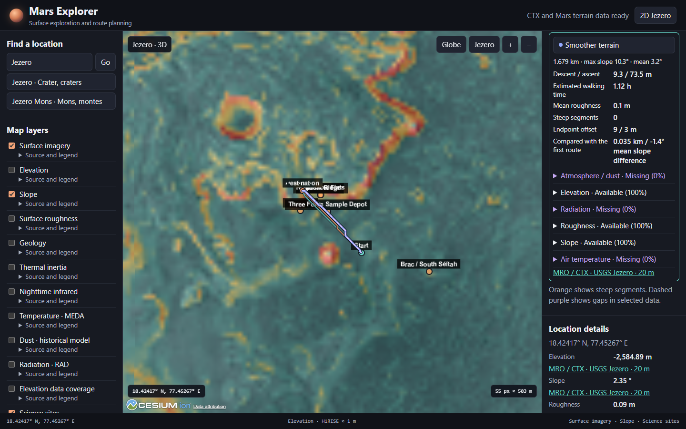
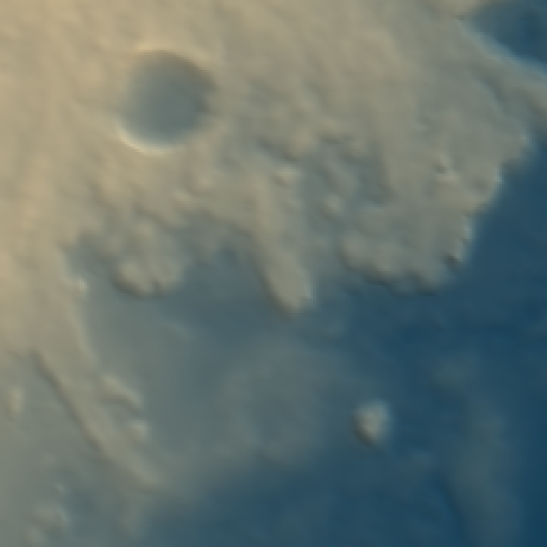
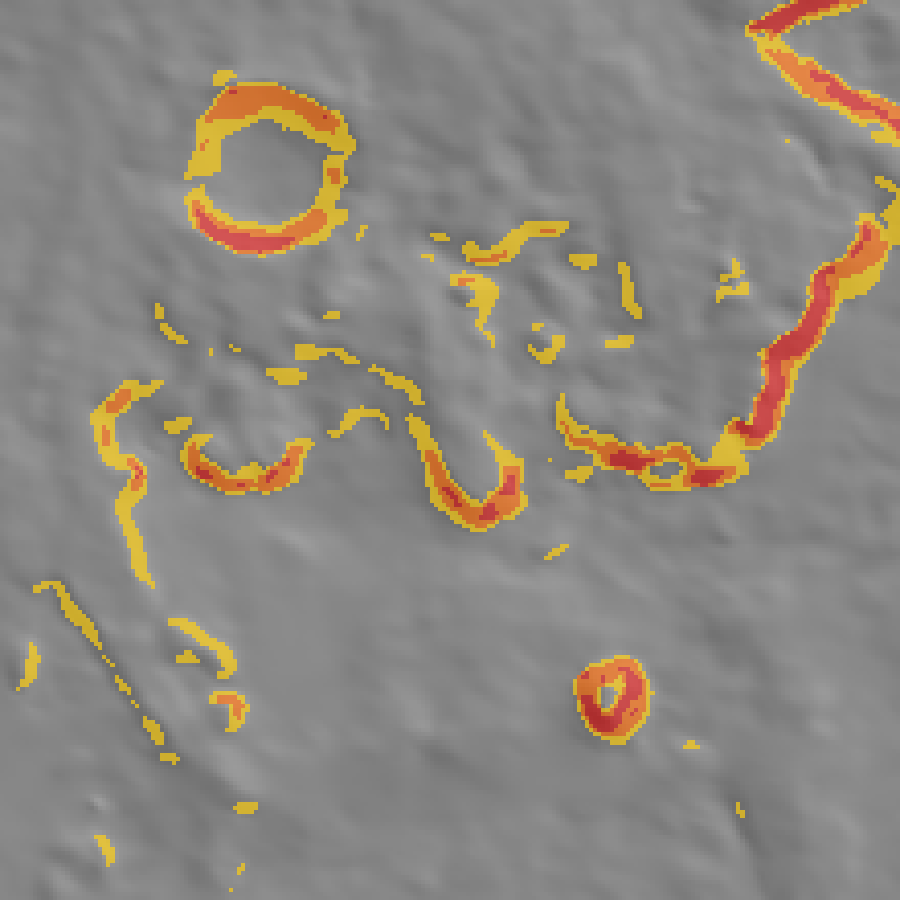
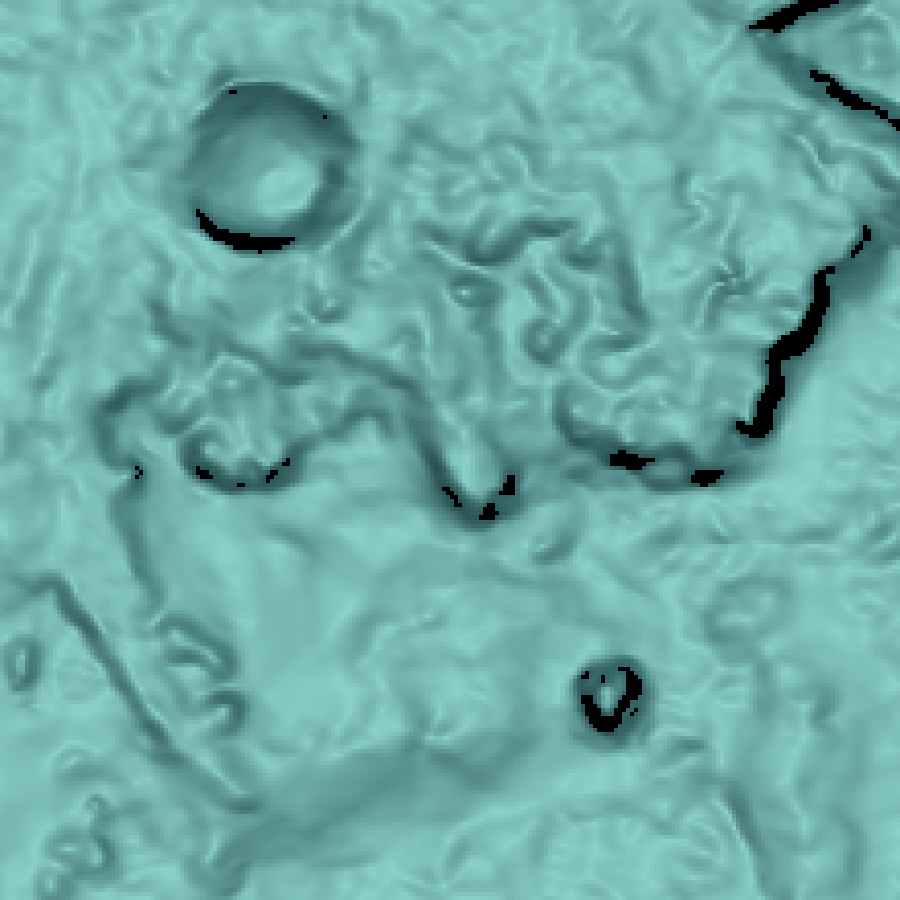
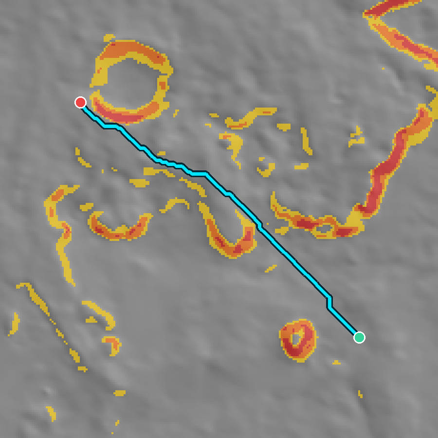

# Mars Explorer — 3D Mars exploration and Jezero route planning

Mars Explorer is Team Manifesto's NASA Space Apps prototype for exploring Mars and comparing candidate astronaut walks at Jezero Crater. The 3D globe uses CesiumJS, and the 2D Jezero map uses Leaflet. A Python Flask API uses Rasterio, NumPy and Pillow to read elevation models, derive terrain layers and compare candidate routes.

- Compare candidate routes by distance, estimated walking time, maximum modeled slope, ascent and descent.
- Toggle terrain, geology and archived environmental layers. Route cards show steep segments and gaps in the selected data.
- Explore Perseverance science locations and archived rover traverses. Use MOLA for coarse regional context and route planning.

## Quick start

From the repository root on Windows PowerShell, with Python 3.10 or later:

```powershell
py -3 -m venv .venv
.\.venv\Scripts\python.exe -m pip install -r backend/requirements.txt
```

### Download terrain data

Run these commands from the repository root. Use the USGS CTX mosaic for the Jezero demo and the NASA PDS MOLA grid for global terrain and coarse regional routes.

```powershell
curl.exe -fL -o data/jezero_dem.tif "https://planetarymaps.usgs.gov/mosaic/mars2020_trn/CTX/ScienceInvestigationMaps_JPL/M20_JezeroCrater_CTXDEM_20m.tif"
curl.exe -fL -o data/explorer/mola16.img "https://pds-geosciences.wustl.edu/mgs/urn-nasa-pds-mgs_mola_topography_derived/meg016/megt90n000eb.img"
```

- **Jezero CTX, 20 m, 90.3 MB.** SHA-256 `ba7f706ea1b5d63a562f28a7dcf7a7f3c79bce7f048e6974b57e8a33c30d1ba2`.
- **MOLA, 16 pixels per degree, 33.2 MB.** SHA-256 `d18d9b9ab8c5516d02e157dd2cde0f1d0d160c21940e953ba22391269a545e7b`. An optional [4-pixel-per-degree grid](https://pds-geosciences.wustl.edu/mgs/urn-nasa-pds-mgs_mola_topography_derived/meg004/megt90n000cb.img) can be saved as `data/explorer/mola.img`. The app chooses the finer available MOLA grid.
- The small Jezero HiRISE elevation crop, MOLA metadata labels, science sites, adapted GeoJSON layers and preview imagery are included. Source archives belong in `data/raw/`, and local intermediate products belong in `data/processed/`. [Sources, processing and credits](docs/explorer-data.md)

### Start the application

```powershell
.\.venv\Scripts\python.exe backend/app.py
```

Open [127.0.0.1:5000](http://127.0.0.1:5000/). Flask serves the frontend and API on the same port. If port 5000 is occupied, run `$env:MARS_PORT = "5055"` before starting and open [127.0.0.1:5055](http://127.0.0.1:5055/). Select **2D Jezero** to open the Leaflet view.

For a separate 2D frontend server, keep Flask on port 5000 and run `python -m http.server 8000` from the repository root in a second terminal. Open [the 2D map](http://localhost:8000/frontend/legacy.html).

### Try the demo

For the demo, enter `18.44, 77.42` as the start and `18.46, 77.40` as the destination. Compare the candidate route cards and open the slope or coverage layers. The dashed purple line marks gaps in selected data. High-resolution Mars Trek tiles and rover photos require an internet connection.

[3D data sources, method and limitations](docs/explorer-data.md).

[English submission draft, slide outline and demo script](docs/submission.md).



## Earlier 2D Jezero application

NASA Space Apps Challenge 2026 · Challenge: **Interplanetary Survival Guide: Martian Map**

Click two points in Jezero Crater, Mars, and get a walking route computed in real time from orbital elevation data. The route avoids slopes steeper than 20° and reports distance, estimated walking time and the steepest slope along the way. A slope-hazard layer shows why the route bends, and Perseverance science sites show what an explorer could study on the walk.

### 2D features

- **Live route computation:** weighted A* on a 20 m/pixel elevation model; a 20 km route takes about 2 seconds.
- **Safety limit:** cells steeper than 20° are never used.
- **Route summary:** distance, estimated walking time, maximum slope.
- **Slope-hazard layer:** yellow 10–15°, orange 15–20°, red above 20° (the route never enters red cells).
- **Science sites:** five Perseverance locations with rover photos, credits and one-sentence science summaries.
- **NASA imagery:** 25 cm/pixel HiRISE base map from NASA Mars Trek.

### 2D data layers

| Layer | Mission / instrument | Source |
|---|---|---|
| Base map, 25 cm/pixel | Mars Reconnaissance Orbiter / HiRISE | NASA Mars Trek |
| Elevation, 20 m/pixel | Mars Reconnaissance Orbiter / CTX | USGS Mars 2020 Science Investigation CTX DEM mosaic |
| Science sites and photos | Mars 2020 Perseverance | Perseverance waypoints and raw images |
| Global context, 463 m/pixel | Mars Global Surveyor / MOLA | NASA Mars Trek |

Full links and credits: [`data_sources.md`](data_sources.md).

## How the route is computed

1. **Elevation:** the CTX DEM is read with rasterio. Its projection (equirectangular on the Mars 2000 sphere) is read from the file and used to convert latitude/longitude to DEM pixels.
2. **Slope** is computed for every 20 m cell.
3. **Walking cost:** Tobler's hiking function converts slope to walking speed, scaled to a 2.2 km/h EVA pace. Each cell's cost is the time needed to cross it.
4. **Safety limit:** cells steeper than 20° or without data are impassable.
5. **Search:** weighted A* (weight 1.2) prioritizes faster search.

| 1 · Elevation | 2 · Slope | 3 · Walking speed | 4 · Route |
|---|---|---|---|
|  |  |  |  |
| Blue = low crater floor, sand = higher delta | Yellow 10–15°, orange 15–20°, red > 20° | Light = fast, dark = slow, black = blocked | Candidate path that stays under 20° |

*Rendered from the real CTX DEM around the delta front with `backend/make_method_panels.py`.*

API details: [`docs/integration.md`](docs/integration.md).

## Testing

- **Python tests:** `python -m pytest -q` from the repository root. Add the terrain downloads before running to exercise real elevation data.
- **JavaScript flow tests:** `node --test tests/frontend-flow.cjs`.
- **Integration test suite and reports:** [`tests/`](tests/) and [`docs/`](docs/)
- **End-to-end browser tests** (headless Firefox): route drawing, reset, error messages, science-site popups, layer panel.
- **Consistency check:** 13 random routes, 6,060 route points; none falls on a cell above the 20° limit. This confirms that the hazard layer and the routing engine are aligned.

## Limitations

- A 20 m elevation model cannot see boulders or small scarps, so real slopes can be steeper than the model shows. **The route is a planning aid, not a safety certification.**
- The 20° limit is a conservative prototype parameter, not a NASA standard.
- The 2.2 km/h walking pace is an adapted assumption, not measured astronaut performance.
- The 2D map uses a 463 m/pixel MOLA hillshade for context. The 3D planner can use the much coarser global MOLA elevation grid outside local DEM coverage.
- Local requests cover at most 30 km of straight-line distance. Global MOLA requests cover at most 1,200 km and are limited to latitudes within 87 degrees of the equator.

## Future work

- Expand detailed elevation coverage beyond the current HiRISE window at Jezero.
- Add a user-adjustable slope limit and multi-stop routes.
- Evaluate astronaut walking-time estimates and add route-relevant environmental measurements where available.

## Earth relevance

The same pipeline (elevation model → slope → walking cost → safest path) applies to search-and-rescue planning, mountain hiking and analog-astronaut field missions. NASA uses Lake Salda in Türkiye as an Earth analogue for Jezero because both have carbonate-bearing lake and delta deposits.

## Repository layout

```
backend/    Flask API, DEM processing, routing, overlay script, tests
frontend/   CesiumJS 3D globe and Leaflet 2D Jezero view
data/       Science sites, compact display layers and local terrain downloads
docs/       Integration guide, test reports, submission draft
tests/      Integration and contract test suite
```

## Team

**Team Manifesto**

- **Yusuf Öztoprak** — Backend & routing; documentation & presentation
- **Yusuf Tunç** — Frontend & map; documentation & presentation
- **Eren Yılmaz** and **Emirsultan Boğatekin** — Data & content
- **Abdullah Demirel** — Integration & testing

## AI usage

AI tools were used for research, coding and testing; every output was reviewed and tested by the team. Details: [`ai_usage.md`](ai_usage.md).

## License

MIT — see [`LICENSE`](LICENSE). NASA/USGS data and imagery keep their own credits; see [`data_sources.md`](data_sources.md).
